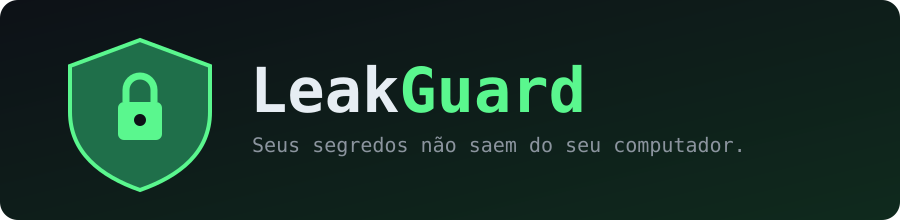
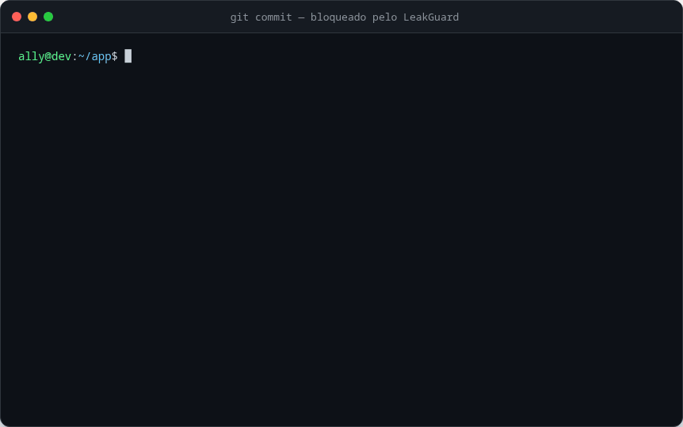
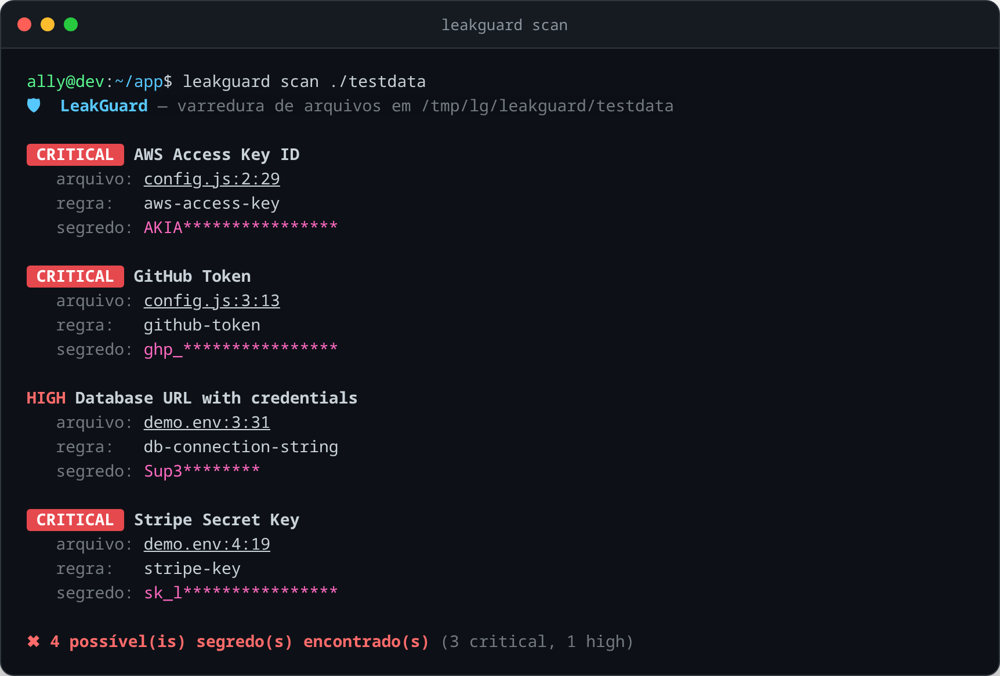
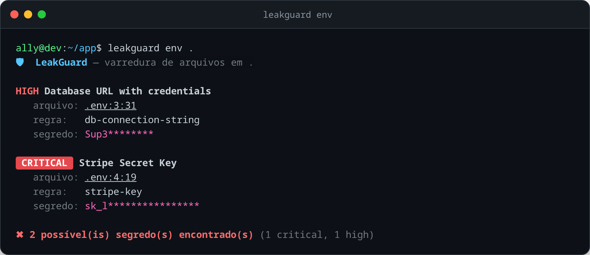
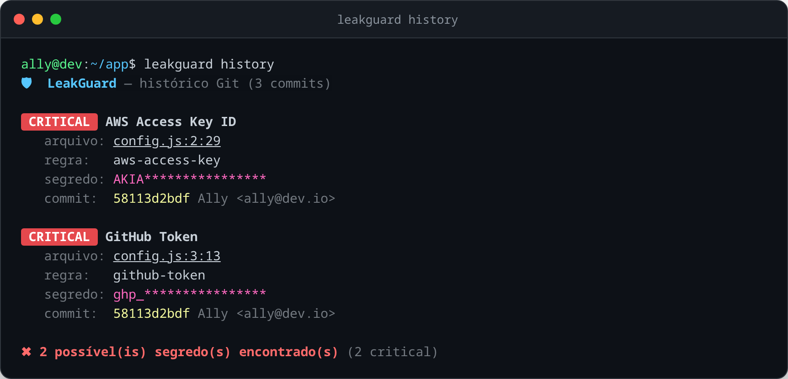
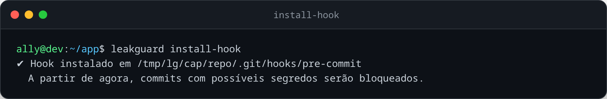

<p align="center">
  
</p>

<p align="center">
  <b>Detector de segredos em projetos.</b> Encontra senhas, tokens e chaves de API <i>antes</i> que eles cheguem ao GitHub.
</p>

<p align="center">
  
  
  
  
  
</p>

---

<p align="center">
  
</p>

## 🤔 O problema

Todo dia, milhares de chaves da AWS, tokens do GitHub e senhas de banco de dados são publicados por acidente em repositórios públicos. Robôs varrem o GitHub em **segundos** atrás dessas credenciais — e um simples `git commit` descuidado pode virar uma conta de nuvem de milhares de reais ou um vazamento de dados.

## 🛡 A solução

O **LeakGuard** é uma ferramenta de linha de comando, escrita em Go, que fica de guarda no seu fluxo de trabalho:

| | Funcionalidade | Como |
|---|---|---|
| 🔑 | **Detecção de chaves de API** | 19 regras para AWS, GitHub, GitLab, Stripe, OpenAI, Anthropic, Google, Slack, Twilio, SendGrid, npm, JWT, chaves privadas, URLs de banco e mais |
| 📄 | **Análise de arquivos `.env`** | Entende a sintaxe dotenv, sinaliza valores reais em chaves sensíveis e ignora modelos como `.env.example` |
| 🕰 | **Verificação do histórico Git** | Percorre todos os commits e mostra **qual commit e qual autor** introduziu o segredo — mesmo que ele já tenha sido apagado |
| ⚙️ | **Integração com GitHub Actions** | Action pronta + relatório SARIF que aparece na aba *Security → Code scanning* |
| ⛔ | **Bloqueio de commits** | Hook `pre-commit` que impede o commit quando algo suspeito está em stage |

Além disso:

- 🧠 **Menos falsos positivos** — cálculo de entropia de Shannon e filtro de placeholders (`changeme`, `${TOKEN}`, `process.env.X`…).
- 🙈 **Segredos mascarados** na saída (`ghp_****************`), para o próprio relatório não virar um vazamento.
- ⚡ **Rápido e portátil** — um único binário, sem dependências externas, para Linux, macOS e Windows.

---

## 📦 Instalação

Com Go instalado:

```bash
go install github.com/allyxzs/leakguard/cmd/leakguard@latest
```

Ou compile a partir do código-fonte:

```bash
make build      # gera ./leakguard
make install    # instala no seu $GOPATH/bin
```

Binários prontos para cada sistema são gerados automaticamente a cada nova versão (veja a aba *Releases*).

---

## 🚀 Uso

### 🔍 Varrer um projeto

```bash
leakguard scan            # diretório atual
leakguard scan ./src      # um diretório específico
```

<p align="center"></p>

### 📄 Analisar arquivos `.env`

```bash
leakguard env .
```

<p align="center"></p>

Variáveis públicas por natureza (`VITE_*_URL`, `NEXT_PUBLIC_*`), valores vazios e placeholders são ignorados automaticamente.

### 🕰 Verificar o histórico Git

```bash
leakguard history                   # todos os branches
leakguard history --max-commits 50  # só os 50 commits mais recentes
leakguard history --rev main        # um branch ou intervalo (ex.: origin/main..HEAD)
```

<p align="center"></p>

> 💡 Repare: o token já tinha sido removido do código, mas **continuava no histórico**. Se isso acontecer, considere a chave comprometida e revogue-a.

### ⛔ Bloquear commits com segredos

```bash
leakguard install-hook     # instala o hook pre-commit no repositório
leakguard uninstall-hook   # remove
```

<p align="center"></p>

A partir daí, todo `git commit` roda `leakguard staged`, que analisa **apenas as linhas adicionadas** no commit. Se algo suspeito aparecer, o commit é bloqueado (veja o GIF no topo). O hook preserva qualquer hook `pre-commit` que já exista e respeita `core.hooksPath`.

Usa o framework [pre-commit](https://pre-commit.com)? Também funciona:

```yaml
# .pre-commit-config.yaml
repos:
  - repo: https://github.com/allyxzs/leakguard
    rev: v1.0.1
    hooks:
      - id: leakguard
```

---

## 🩹 Atualização 1.0.2

Os exemplos agora usam variáveis de ambiente ou campos vazios. Os testes geram
amostras sintéticas apenas durante a execução, sem armazenar tokens completos
no código. Veja [SECURITY_REVIEW.md](SECURITY_REVIEW.md) para a análise e as
orientações sobre alertas antigos no GitHub, e [CHANGELOG.md](CHANGELOG.md).

O `.leakguardignore` e o comentário `leakguard:allow` só afetam o LeakGuard.
Eles não desativam o Secret scanning do GitHub.

## ⚙️ GitHub Actions

Adicione ao seu repositório em `.github/workflows/leakguard.yml`:

```yaml
name: LeakGuard
on: [push, pull_request]

permissions:
  contents: read
  security-events: write

jobs:
  secrets:
    runs-on: ubuntu-latest
    steps:
      - uses: actions/checkout@v4
        with:
          fetch-depth: 0          # histórico completo
      - uses: allyxzs/leakguard@v1
        with:
          mode: history           # scan | history | env
      - uses: github/codeql-action/upload-sarif@v3
        if: always()
        with:
          sarif_file: leakguard.sarif
```

| Entrada | Padrão | Descrição |
|---|---|---|
| `mode` | `history` | `scan`, `history` ou `env` |
| `path` | `.` | Diretório analisado |
| `sarif` | `true` | Gera `leakguard.sarif` para o Code Scanning |
| `fail-on-findings` | `true` | Falha o job quando houver segredos; erros de execução sempre falham |

O job falha quando encontra segredos e os achados aparecem como alertas na aba **Security** do repositório.

---

## 🎛 Opções

| Opção | Descrição |
|---|---|
| `--format text\|json\|sarif` | Formato do relatório |
| `--output arquivo` | Salva o relatório em arquivo |
| `--show-secrets` | Mostra os segredos sem máscara (cuidado!) |
| `--no-fail` | Retorna 0 quando há achados; erros continuam retornando 2 |
| `--no-color` | Saída sem cores (também respeita `NO_COLOR`) |

**Códigos de saída:** `0` nada encontrado · `1` segredos encontrados · `2` erro.

```bash
leakguard scan --format json --output relatorio.json
leakguard rules     # lista todas as regras de detecção
```

---

## 🙈 Ignorando falsos positivos

**Em uma linha** — adicione o comentário `leakguard:allow`:

```js
const exemplo = "EXEMPLO_SEM_CREDENCIAL"; // leakguard:allow
```

**Em arquivos ou pastas** — crie um `.leakguardignore` na raiz (um padrão por linha):

```gitignore
fixtures/**
*.snap
docs/exemplos.md
```

Por padrão já são ignorados `.git/`, `node_modules/`, `vendor/`, `dist/`, `build/`, imagens, arquivos compactados e lockfiles.

---

## 🔑 Regras de detecção

| Severidade | Detecta |
|---|---|
| 🔴 **CRITICAL** | AWS Access Key / Secret Key · GitHub Token / Fine-grained PAT · GitLab PAT · Stripe Live Key · OpenAI · Anthropic · Chaves privadas (RSA, EC, OpenSSH, PGP) |
| 🟠 **HIGH** | Google API Key · Slack Token / Webhook · Twilio · SendGrid · npm Token · URL de banco com senha · Valores sensíveis em `.env` |
| 🟡 **MEDIUM** | JWT · Discord Webhook · Atribuições genéricas (`password=`, `api_key:`, `token :=`…) com alta entropia |

---

## 🏗 Como funciona

```text
                ┌──────────────┐
 arquivos  ───▶ │              │      ┌────────────┐
 .env      ───▶ │   Scanner    │ ───▶ │  Relatório │ ──▶ texto · JSON · SARIF
 git diff  ───▶ │ regex +      │      └────────────┘
 git log   ───▶ │ entropia +   │            │
                │ placeholders │            ▼
                └──────────────┘      código de saída 1 ──▶ commit / CI bloqueado
```

```text
cmd/leakguard/      interface de linha de comando
internal/rules/     regras de detecção (regex + severidade + entropia mínima)
internal/scanner/   varredura de arquivos, análise .env e entropia
internal/gitscan/   mudanças em stage e histórico Git
internal/hook/      instalação do hook pre-commit
internal/report/    saídas em texto colorido, JSON e SARIF
action.yml          GitHub Action
```

## 🧪 Testes

```bash
make test
```

Os testes cobrem as 19 regras de detecção, filtros de placeholder, análise de
`.env`, máscara de segredos, padrões de ignore e a varredura de stage e de
histórico em um repositório Git temporário. As amostras são construídas por
`internal/testfixture` durante os testes e nunca são credenciais de um serviço.
Um teste de higiene percorre os arquivos do projeto, incluindo os testes e
exemplos ignorados pelo fluxo normal, para impedir tokens completos de provedores.

Os arquivos de `testdata/` são exemplos seguros e devem produzir zero achados.
As capturas neste README ilustram a detecção de amostras sintéticas de versões
anteriores; os valores exibidos estão mascarados.

## 🚨 Encontrei um segredo. E agora?

1. **Revogue a credencial** imediatamente no serviço de origem — apagar do código não basta.
2. Gere uma nova e guarde-a em variáveis de ambiente ou num cofre de segredos.
3. Se precisar remover o conteúdo do histórico, planeje a limpeza e coordene-a com os colaboradores. Um commit de correção não remove versões anteriores.
4. Adicione `.env` ao `.gitignore` e versione só um `.env.example`.

## 📄 Licença

[MIT](LICENSE) © Allyson Santos
